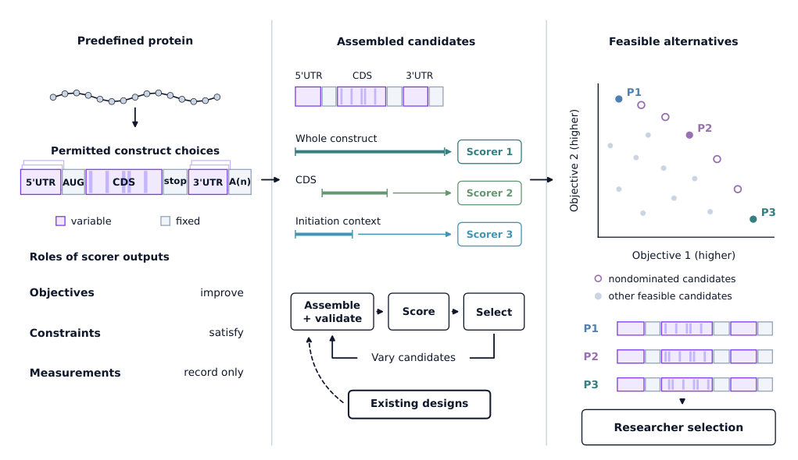

# MORSE

**Multi-Objective RNA Sequence Evolution**

MORSE is a configurable multi-objective framework for joint search over synonymous
coding variants and untranslated regions selected from defined libraries.
Researchers specify scorer inputs and assign outputs as objectives, constraints
or recorded measurements. Search retains feasible nondominated candidates for
selection after optimization.

Use MORSE to refine existing mRNA designs, explore trade-offs between predictors
and run experiments with your own sequences, scorer modules and constraints.

[](paper/reference/Figure1_design_workflow.pdf)

## Install

Install Git and [uv](https://docs.astral.sh/uv/getting-started/installation/),
then clone MORSE and set up the Python environment:

```sh
git clone https://github.com/AIRI-Institute/MORSE.git
cd MORSE
uv sync --python 3.13 --all-packages --extra paper --frozen
```

`uv sync` creates a virtual environment in `.venv` and installs MORSE. Activate
it to use the `morse` command directly:

```sh
source .venv/bin/activate
morse run --config examples/quickstart/experiment.yaml
```

For native MFE scoring on CPU, include the `mfe` extra:

```sh
uv sync --python 3.13 --all-packages --extra paper --extra mfe --frozen
```

For notebook use, also include `--extra notebook` in this command.

With Python 3.10–3.13, a pip alternative is:

```sh
python3 -m venv .venv
source .venv/bin/activate
python -m pip install ./core ./warm-starter ./scorers/manufacturability '.[mfe]'
```

The pip command installs compatible dependencies; use the uv lock for reference
reproduction. See the [MFE setup and YAML example](scorers/viennarna/README.md#native-cpu-setup).

## Quick start

Run the bundled CPU example:

```sh
uv run morse validate --config examples/quickstart/experiment.yaml
uv run morse run --config examples/quickstart/experiment.yaml
```

Results are saved in `outputs/quickstart/`: candidate sequences in FASTA,
score tables and `report.md`.

## Configure an experiment

Start with the [commented configuration template](examples/experiment.template.yaml)
or the [working MAGE-A1 example](examples/vaccines/magea1/experiment.yaml).
The YAML defines the input sequence and part coordinates, allowed changes,
scorer commands, parameters, metric roles and search settings. In schema 5, supply
the CDS body without its start and stop codons; set them separately in
`construct.start_codon: [AUG]` and `construct.stop_codon: [UAA]`. Add list entries
to let MORSE choose between them. UTRs and poly(A) are optional.
Older schema-3/4 configurations, including the paper runs, retain their original
input format.

To create a configuration from your own CDS-body FASTA:

```sh
uv run morse init --cds antigen.fasta --output-dir experiments/my-run
```

Edit `experiments/my-run/experiment.yaml`, then check the configuration,
score the starting construct and launch optimization:

```sh
uv run morse validate --config experiments/my-run/experiment.yaml
uv run morse score --config experiments/my-run/experiment.yaml
uv run morse run --config experiments/my-run/experiment.yaml
```

Use `optimize` metrics with `direction: min` or `max`, `threshold` metrics
with bounds, and `log` metrics to record additional measurements.
See the [researcher guide](docs/researcher-guide.md) for sequence assembly,
UTR libraries and search options, and [examples/](examples/) for complete configs.

## Connect scorers

Each scorer is called through a Bash command in the YAML. The command can run
a local program, a Docker container or a client for an existing service.
Put calculation settings in the scorer's optional `parameters` mapping. Omitted
settings keep the scorer's defaults.
See the [parameter reference](docs/scorer-parameters.md) and a
[CPU example](examples/scorer-parameters/experiment.yaml).

List the available scorers, inspect an interface and generate its YAML section:

```sh
uv run morse scorers
uv run morse scorers describe cai
uv run morse scorers template cai \
  --command '"${MORSE_PYTHON}" -m scorers.cai.server'
```

Replace the experiment's `scorers` section with the generated section and
run `morse score` to check the connection. Add further scorers to the same list.

The [scorer catalog and setup guide](docs/scorers.md) lists container images,
runtime requirements and instructions for connecting your own scorer.

## Python API

Use the same experiment configuration from Python:

```python
import morse

params = morse.load_config("experiment.yaml")
result = morse.optimize(params=params, verbose=2)
result.pareto
```

Pass an RNA string as the first argument to use it instead of the configured
FASTA: `morse.optimize(rna_seq, params, verbose=2)`. The part coordinates remain
in the configuration and refer to the supplied input before codon insertion.
Notebook progress can include metric, hypervolume and UTR frequency plots.

See the [Python guide](docs/python-api.md) and the
[CPU example notebook](core/notebooks/MORSE_Python_API.ipynb) for scoring,
optimization, candidate selection and continuation.

## Colab and Jupyter

The [notebook](core/notebooks/MORSE_Server_Colab.ipynb) provides a graphical
interface for editing experiment YAML, launching and monitoring runs, and
viewing results through the Python API. Optimization runs in the notebook's
active kernel; progress and plots update in the launch cell. To use server
hardware, run the notebook with a kernel on that server.

For local notebook use, install the notebook dependencies:

```sh
uv sync --all-packages --extra paper --extra mfe --extra notebook --frozen
```

## Reproduce the paper

The [paper directory](paper/README.md) contains study configurations, results
and figure-generation scripts. Recompute the analysis and figures from the
provided data:

```sh
uv run morse paper analyze --output outputs/paper
uv run morse paper figures --output outputs/paper
```

To repeat an optimization, prepare its configured scorers and pass the study's
YAML to MORSE:

```sh
uv run morse run --config paper/configs/f2_filtered_s7.yaml
```

See [the study guide](paper/README.md) and
[paper scorer settings](paper/SCORERS.md) for the full experiment list and setup.

## License

MORSE code is distributed under the [MIT license](LICENSE).
Third-party software, models and data retain their own licenses; see
[THIRD_PARTY_NOTICES.md](THIRD_PARTY_NOTICES.md).
