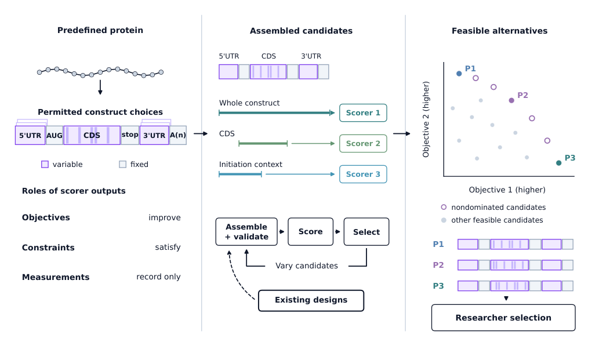

# MORSE

**Multi-Objective RNA Sequence Evolution**

MORSE optimizes mRNA constructs while preserving the encoded protein. It searches
over synonymous CDS variants, UTRs selected from supplied libraries, start and
stop codons, and poly(A) lengths.

Define the properties to optimize, set constraints, and connect the scorers needed
for your experiment. MORSE returns candidate sequences, their scores, and an
optimization report. With multiple objectives, the result is a Pareto set:
alternatives representing different trade-offs between the objectives. Model scores
are predictions; expression and RNA stability must be measured experimentally.

Run experiments from the command line, Python, or a graphical notebook using the
same YAML configuration.

[](paper/reference/Figure1_design_workflow.pdf)

<a id="install"></a>

## First run

Clone the repository and install the locked environment with [uv](https://docs.astral.sh/uv/getting-started/installation/):

```sh
git clone https://github.com/AIRI-Institute/MORSE.git
cd MORSE
uv sync --python 3.13 --all-packages --extra mfe --frozen
source .venv/bin/activate
```

<details>
<summary>Install with pip and venv instead (Python 3.10–3.13)</summary>

From the cloned repository:

```sh
python3 -m venv .venv
source .venv/bin/activate
python -m pip install ./core ./warm-starter ./scorers/manufacturability '.[mfe]'
```

</details>

Run the [CPU example](examples/quickstart/experiment.yaml) from the repository root.
It uses a bundled scorer to minimize CpG frequency and distance from 50% GC.
No GPU, model download or scorer service is needed.

```sh
morse run --config examples/quickstart/experiment.yaml
```

Open `outputs/quickstart/report.md` for the scores and plots. To run the same
example from Python instead:

```python
import morse

params = morse.load_config("examples/quickstart/experiment.yaml")
result = morse.optimize(params=params, output_dir="outputs/quickstart_python")
```

For live plots in Jupyter, [install notebook support](docs/python-api.md) and set
`verbose=2`. The [Python notebook](core/notebooks/MORSE_Python_API.ipynb)
walks through the example. The [graphical notebook](core/notebooks/MORSE_Server_Colab.ipynb)
lets you build a YAML configuration using forms.

## Run with your own sequence

**CDS only:** provide a single-record FASTA with the CDS body in DNA or RNA.
In schema 5, the body excludes the initiation codon and the terminal stop codon.
Generate an experiment directory with:

```sh
morse init --cds cds_body.fasta --output-dir experiments/my_run
```

**CDS with UTRs:** add `--five-prime-utr utr5.fasta` or
`--three-prime-utr utr3.fasta` to the same command. If the parts are already in
one FASTA, use the [commented config template](examples/experiment.template.yaml)
and set their coordinates directly. Coordinates start at zero, exclude the end,
and cover the input without gaps. Only the CDS body is required.

```text
Input FASTA:   [5′UTR]         CDS body          [3′UTR]  [poly(A)]
Assembled RNA: [5′UTR]  start  CDS body   stop   [3′UTR]  [poly(A)]
```

## Configure an experiment

Edit `experiments/my_run/experiment.yaml`. For a complete config with multiple
scorers, see the [annotated working example](examples/scorer-parameters/experiment.yaml).

| YAML section | What to set |
|---|---|
| `construct` | Input FASTA, part coordinates and allowed start/stop codons (default AUG/UAA; first entries define the reference). Under `changes`, enable synonymous CDS changes, UTR choices from libraries, or poly(A) length choices. Unlisted parts stay fixed unless the start/stop lists contain alternatives. |
| `optimizer` | Search algorithm (`ga` for one objective; `nsga2` or `nsga3` for multiple), population size, generation limit and random seed. Optional: `n_offsprings` per generation and `early_stopping`. |
| `scorers` | One entry for each scorer: a name, the command that calls it, the sequence region it receives, and the metrics to use. |
| `output_dir` | A new directory for each independent run. Relative paths for the input, libraries and results are resolved from the YAML location. |

For example, this entry calls the MFE scorer installed above:

```yaml
scorers:
  - name: mfe
    command: '"${MORSE_PYTHON}" -m scorers.viennarna.scorer'
    scope: [five_prime_utr, cds, three_prime_utr]
    parameters:
      max_bp_span: 300  # nt
    metrics:
      mfe: {role: optimize, direction: min}
      gc_fraction: {role: threshold, min: 0.35, max: 0.65}
```

- **`scope` selects what is scored.** Here the scorer receives the assembled transcript without poly(A). In a scorer scope, `cds` includes start and stop; `cds_body` excludes both. Use `full_sequence` for the whole construct.
- **`parameters` sets how the score is calculated.** Here base pairs can span up to 300 nt. Omitted parameters keep the scorer's defaults.
- **`metrics` sets how scores are used.** Use `optimize` with `direction: min|max`, `threshold` with `min`, `max` or `equals`, and `log` for values you only want to record.

Each command must work in your environment before the run. It can call a local
script, a container or a running service. Use `morse scorers` to list bundled
scorers and `morse scorers describe viennarna` to inspect the MFE scorer. See the
[scorer setup guide](docs/scorers.md) and [parameter reference](docs/scorer-parameters.md).

## Check before a long run

From the repository root:

```sh
config=experiments/my_run/experiment.yaml
morse validate --config "$config"
morse score --config "$config"
morse pilot --config "$config" --samples 24 --output-dir outputs/my_pilot
morse run --config "$config"
```

`validate` checks the configuration and sequence structure without invoking the
scorers. `score` runs them on the starting construct. `pilot` scores the reference
and a small sample of variants: inspect the feasible fraction, metric ranges and
warnings before committing to the full run. A threshold that no sampled variant
passes is a reason to inspect the setup, not proof that no solution exists.

## Choose and export a candidate

The final Pareto set contains feasible candidates with different trade-offs.
Use HVC (exclusive hypervolume contribution) to pick a candidate that adds the
most to the set's coverage. If one metric matters most, select its specialist
instead. The two choices can return the same candidate.

Inspect the completed CPU example without rerunning any scorers:

```python
import morse

run = morse.load_run("outputs/quickstart")  # CLI example
compromise = run.select("hvc")
specialist = run.select(metric="sequence_metrics.cpg_per_kb")
for row in run.compare([compromise, specialist], baseline=run.reference):
    print(row["candidate_id"], row["metric"], row["baseline"], row["value"], row["delta"])

compromise.to_fasta(run.output_dir / "selected.fasta")
```

`run.reference` is the starting construct scored in this run. A delta is
candidate minus baseline in the metric's own units; for a minimized metric,
a negative delta is better. To export a candidate you chose in the report,
pass its ID to `run.get_candidate(candidate_id)` and call `to_fasta(path)`.

| In the run directory | Contents |
|---|---|
| `report.md` | Summary and plots |
| `pareto.csv`, `pareto.fasta` | Final Pareto scores and assembled sequences, matched by candidate ID |
| `summary.json`, `progress.json` | Starting scores, run summary and progress |
| `resolved_run.yaml` | Resolved experiment configuration |

To continue an interrupted run, use `morse run --config "$config" --resume` or
`morse.resume(output_dir)` in the original environment.

## Guides and citation

- [Researcher guide](docs/researcher-guide.md) and [Python API](docs/python-api.md): input options, progress, analysis and continuation.
- [Model cards](docs/model-cards.md) and [custom scorer example](examples/custom_scorer): interpret a predictor's outputs or connect your own tool.
- [Reproduce the paper](paper/README.md): regenerate figures from saved data or rerun a published configuration.
- [Cite MORSE](CITATION.cff). MORSE uses the [MIT license](LICENSE); see [third-party notices](THIRD_PARTY_NOTICES.md) for bundled components.
